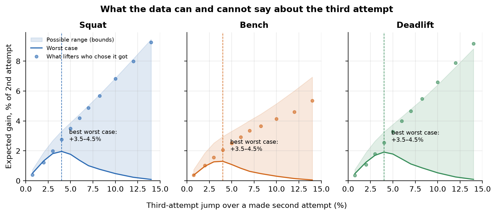

# Third Attempt

What 12 million powerlifting attempts can and cannot say about attempt selection.

This repository contains the research paper, the full analysis pipeline and a free web calculator. It uses every competition attempt recorded in [OpenPowerlifting](https://www.openpowerlifting.org) from 2000 to 2026: 12,163,164 attempts by 572,553 lifters at 32,150 meets in 420 federations.

- **Calculator:** [dek0rta.github.io/third-attempt](https://dek0rta.github.io/third-attempt/) (static site, runs fully in the browser; source in [`web/`](web/))
- **Paper:** [`paper/paper.pdf`](paper/paper.pdf)
- **Author:** Zakhar Sukhanov · [zexa1993@outlook.com](mailto:zexa1993@outlook.com) · [LinkedIn](https://www.linkedin.com/in/zakhar-sukhanov-1ba2313b6/)

## Findings

1. **Third attempts are close to coin flips.** They are made 64% of the time in the squat, 60% in the deadlift and 46% in the bench press.
2. **Heavy openers bomb out more.** Bench openers just above the lifter's previous competition best end in three misses 5.8% of the time, against about 1% for openers at 85–92% of it. Selection bias works *against* this finding, so the true effect is likely larger.
3. **The jump paradox.** Success *rises* with jump size up to about 6–7%. A heavier bar is never easier for the same lifter on the same day, so this is selection: lifters jump big when the last attempt felt easy. Naive models fitted to these data recommend the largest jump allowed.
4. **A 3–4.5% third attempt has the best guaranteed gain.** With only one assumption, that a heavier weight is never easier (monotone treatment response, Manski 1997), the jump with the highest worst-case expected gain is 3.5–4.5% in all three lifts. Across subgroups it stays between 2.5% and 4.5%.
5. **Attempts are hard to predict.** Models tested on 2025–26 meets are well calibrated, but their AUC is only 0.60–0.65. Adding the lifter's own history raises it to at most 0.67.
6. **Misses travel.** Each early squat or bench miss lowers the odds of making the deadlift opener by about a quarter (odds ratio 0.76, 95% CI 0.75–0.77). This holds after adjusting for the opener's weight and the day's form, with standard errors clustered by lifter.



## Reproduce

Requires [uv](https://docs.astral.sh/uv/) and Node 20+.

```bash
./scripts/reproduce.sh
```

This downloads the OpenPowerlifting snapshot (about 170 MB zipped) and runs the whole pipeline. It writes every number in `results/`, every figure in `figures/`, the browser model in `web/model.json` and the paper. It takes a few minutes on a laptop. The results here were built from the 10 October 2026 snapshot; newer snapshots will move the numbers slightly.

| Step | Script | Output |
| --- | --- | --- |
| Attempt-level table | `analysis/01_prepare.py` | `data/processed/attempts.parquet` |
| Descriptive results | `analysis/02_descriptive.py` | `results/descriptive.json`, figures 1–5 |
| Success models, out-of-time validation | `analysis/03_model.py` | `results/model_metrics.json`, `web/model.json`, figure 6 |
| Bounds, carry-over, robustness | `analysis/04_decisions.py` | `results/decisions.json`, `web/context.json`, figures 7–8 |
| JS model = Python model | `tests/predict.test.mjs` | 720 real situations, tolerance 1e-9 |
| Paper | `paper/build.py` | `paper/paper.pdf` |

## Calculator

`web/` is a dependency-free static site. To run it locally:

```bash
cd web && python3 -m http.server 8000
```

The lifter enters a previous best and their attempts so far. For every weight they could call next, the calculator shows how often lifters in that situation made it. For openers it also shows the bomb-out risk. Following the paper, it describes outcomes rather than prescribing them. It does not show an "expected gain" column, because that would reproduce the jump-paradox artifact. Instead it flags rare jumps and highlights the 3–4.5% band.

## Data and license

Data: OpenPowerlifting, public domain. Code: MIT. If you use this work, please cite the paper:

> Sukhanov, Z. (2026). *The Jump Paradox: What 12 Million Powerlifting Attempts Can and Cannot Say About Attempt Selection.* https://github.com/Dek0rta/third-attempt
